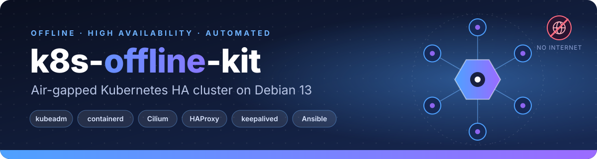
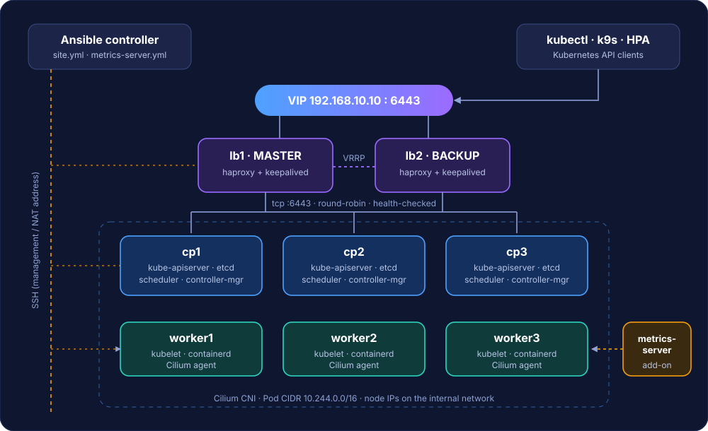
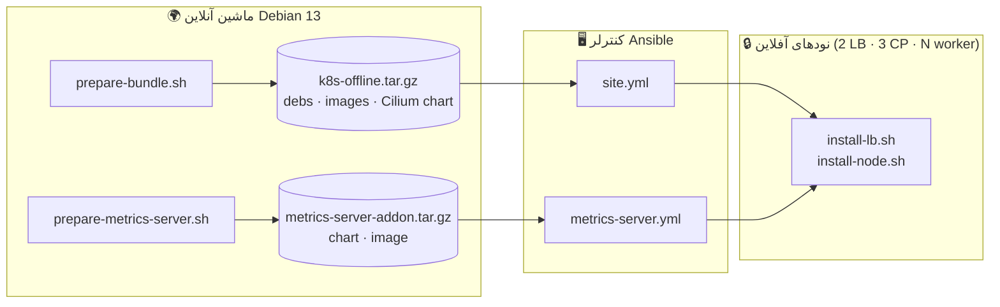
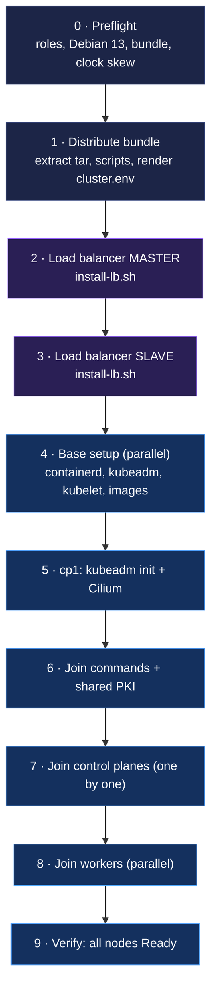

<p align="center">
  
</p>

<p align="center">
  
  
  
  
  
  
  
</p>

<p align="center">
  <a href="README.md">English</a> · <b>فارسی</b>
</p>

<div dir="rtl" align="center">

راه‌اندازی **کلاستر Kubernetes با دسترسی بالا (HA)** روی ماشین‌های **Debian 13 بدون اینترنت**،
فقط با یک دستور Ansible و یک بسته‌ی آماده.

</div>

---

<div dir="rtl">

## ✨ ویژگی‌ها

- 🔌 **نصب کاملاً آفلاین** — همه‌ی بسته‌های `.deb`، ایمیج‌های کانتینری و chartهای Helm یک‌بار روی یک ماشین آنلاین جمع می‌شوند و به‌صورت tarball منتقل می‌شوند.
- 🏗️ **دسترسی بالا** — ۲ لود بالانسر (HAProxy + keepalived با VIP)، ۳ control-plane (etcd) و N ورکر.
- 🤖 **یک دستور** — `ansible-playbook site.yml` همه‌چیز را به ترتیب درست انجام می‌دهد و اجرای دوباره‌اش امن است.
- 🐝 **Cilium** به‌عنوان CNI، از chart محلی نصب می‌شود.
- 📊 **افزونه‌ی metrics-server** — `kubectl top`، نمایش متریک در k9s و HPA.
- 🧩 **زیرِ همه‌چیز bash ساده است** — هر مرحله یک اسکریپت مستند است که می‌توانی دستی اجرا کنی.
- 🌐 **پشتیبانی از چند کارت شبکه** — ماشین‌ها را با آدرس NAT مدیریت کن، در حالی که کلاستر روی شبکه‌ی داخلی کار می‌کند.

## 🗺️ معماری

</div>

<p align="center">
  
</p>

<div dir="rtl">

| نقش | تعداد | چه چیزی اجرا می‌کند |
|---|---|---|
| لود بالانسر | ۲ | HAProxy (‏TCP روی `:6443`، round-robin، با health check) + keepalived (‏VIP با VRRP) |
| Control plane | ۳ | kube-apiserver، etcd، scheduler، controller-manager، kubelet، containerd |
| Worker | ۱ تا N | kubelet، containerd، Cilium (+ replicaهای metrics-server) |
| کنترلر Ansible | ۱ | `ansible-core`، `sshpass` و همین مخزن |

**VIP مربوط به keepalived همان endpoint کلاستر است** (`--control-plane-endpoint`)؛ یعنی kubelet، `kubectl` و نودهای در حال join همگی از طریق لود بالانسرها با API صحبت می‌کنند.

## 🔄 نحوه‌ی کار

دو مرحله: **یک‌بار آنلاین جمع‌آوری** → **چندبار آفلاین نصب**.

</div>



<div dir="rtl">

### ترتیب اجرای playbook ‏(`ansible/site.yml`)

</div>



<div dir="rtl">

## 📋 پیش‌نیازها

| کجا | چه چیزی |
|---|---|
| **ماشین آنلاین** (یک‌بار) | Debian 13 با همان معماری CPU نودها، دسترسی اینترنت، root. یک VM موقت بهترین گزینه است. |
| **کنترلر Ansible** | `ansible-core` و `sshpass` (اگر با password وارد می‌شوی). فقط به شبکه‌ی نودها نیاز دارد، نه اینترنت. |
| **همه‌ی نودها** | Debian 13، `python3`، `sudo`، یک کاربر برای ورود Ansible و ساعت هماهنگ (مثلاً chrony داخلی). |
| **اندازه** | ۲ لود بالانسر + ۳ control-plane + حداقل ۱ ورکر. با ۲+۳+۳ تست شده است. |
| **شبکه** | پیشنهاد: کارت شبکه‌ی دوم روی subnet داخلی برای ترافیک کلاستر و VIP. |

نصب ابزار روی کنترلر (آنلاین): `sudo apt install -y ansible-core sshpass`.
اگر کنترلر هم آفلاین است، `ansible-core sshpass` را به `PKGS` در `prepare-bundle.sh` اضافه کن و از ریپوی محلی bundle نصب کن.

## 🚀 شروع سریع

</div>

```bash
git clone https://github.com/alikashki/k8s-offline-kit.git
cd k8s-offline-kit
```

<div dir="rtl">

**۱ · ساخت bundleها** — روی یک ماشین *آنلاین* Debian 13:

</div>

```bash
sudo ./prepare-bundle.sh            # → k8s-offline.tar.gz          (debs, images, Cilium chart)
sudo ./prepare-metrics-server.sh    # → metrics-server-addon.tar.gz (chart, image)
```

<div dir="rtl">

کل پوشه (با هر دو tarball) را روی کنترلر Ansible کپی کن.

**۲ · توصیف ماشین‌ها** — روی کنترلر:

</div>

```bash
cd ansible
cp inventory.example.ini inventory.ini
$EDITOR inventory.ini group_vars/all.yml
```

```ini
[lb_master]
lb1 ansible_host=203.0.113.11 node_ip=192.168.10.11

[lb_slave]
lb2 ansible_host=203.0.113.12 node_ip=192.168.10.12

[cp_first]
cp1 ansible_host=203.0.113.21 node_ip=192.168.10.21

[cp_other]
cp2 ansible_host=203.0.113.22 node_ip=192.168.10.22
cp3 ansible_host=203.0.113.23 node_ip=192.168.10.23

[workers]
worker1 ansible_host=203.0.113.31 node_ip=192.168.10.31
worker2 ansible_host=203.0.113.32 node_ip=192.168.10.32
worker3 ansible_host=203.0.113.33 node_ip=192.168.10.33
```

<div dir="rtl">

- `ansible_host` — آدرسی که Ansible با **SSH** به آن وصل می‌شود (مثلاً آدرس NAT).
- `node_ip` — آدرس **داخلی** که نودها با هم استفاده می‌کنند (در `/etc/hosts`، backendهای HAProxy، `--node-ip` در kubelet و advertise address می‌رود).
- نام control-planeها **حتماً** باید `cp1`، `cp2` و ... باشد (backendهای HAProxy از روی این نام‌ها ساخته می‌شوند).

**۳ · ساخت کلاستر:**

</div>

```bash
ansible-playbook site.yml
```

<div dir="rtl">

**۴ · افزودن metrics-server:**

</div>

```bash
ansible-playbook metrics-server.yml
```

<div dir="rtl">

**۵ · استفاده:**

</div>

```bash
ssh cp1
sudo kubectl --kubeconfig /etc/kubernetes/admin.conf get nodes -o wide
sudo kubectl --kubeconfig /etc/kubernetes/admin.conf top nodes
```

<div dir="rtl">

> [!IMPORTANT]
> فایل `inventory.ini` اطلاعات ورود دارد و در **git نادیده گرفته می‌شود**. رمزها را با `ansible-vault` رمزگذاری کن و قبل از نصب مقدار `vrrp_auth_pass` را در `group_vars/all.yml` عوض کن.

## ⚙️ پیکربندی

| فایل | کاربرد | کی ویرایش می‌شود |
|---|---|---|
| `ansible/inventory.ini` | ماشین‌ها، نقش‌ها (groupها)، اطلاعات SSH و sudo و `node_ip` | هر محیط |
| `ansible/group_vars/all.yml` | VIP، pod CIDR، تنظیمات VRRP و افزونه‌ها، مسیرها | هر محیط |
| `ansible/templates/cluster.env.j2` | ساخت `cluster.env` روی هر نود از روی inventory | به‌ندرت |
| `bundle.env` | نسخه‌های **زمان ساخت**: کانال Kubernetes، Cilium، chart مربوط به metrics-server | وقتی نسخه‌ی دیگر می‌خواهی ← bundle را دوباره بساز |
| `cluster.env` | همان داده‌های `group_vars` برای اجرای **دستی** اسکریپت‌ها | فقط اجرای دستی |

تنظیمات رایج در `group_vars/all.yml`:

</div>

```yaml
vip: "192.168.10.10"             # keepalived VIP = cluster endpoint
pod_cidr: "10.244.0.0/16"
vrrp_interface: "eth1"           # NIC that carries the VIP
vrrp_auth_pass: "CHANGEME"       # 1-8 alphanumerics, same on both LBs
metrics_server_replicas: 2
metrics_server_insecure_tls: true  # lab default
```

<div dir="rtl">

## 🗂️ ساختار مخزن

</div>

```text
k8s-offline-kit/
├── assets/
│   ├── banner.svg
│   └── architecture.svg
├── ansible/
│   ├── ansible.cfg
│   ├── inventory.example.ini      # copy → inventory.ini (git-ignored)
│   ├── group_vars/
│   │   └── all.yml                # VIP, pod CIDR, VRRP, add-on settings
│   ├── templates/
│   │   └── cluster.env.j2         # cluster.env rendered from the inventory
│   ├── site.yml                   # builds the whole cluster
│   └── metrics-server.yml         # installs the metrics-server add-on
├── prepare-bundle.sh              # ONLINE: debs + images + Cilium chart  → k8s-offline.tar.gz
├── prepare-metrics-server.sh      # ONLINE: chart + image                 → metrics-server-addon.tar.gz
├── install-lb.sh                  # offline: HAProxy + keepalived on a load balancer
├── install-node.sh                # offline: base / init / cilium / join / add-ons on a k8s node
├── bundle.env                     # build-time versions
├── cluster.env                    # per-environment settings for manual runs
├── LICENSE
├── README.md
└── README.fa.md
```

<div dir="rtl">

فایل‌های تولیدشده و **نادیده‌گرفته‌شده در git**: `k8s-offline/`، `k8s-offline.tar.gz`، `metrics-server-addon/` و `metrics-server-addon.tar.gz`.

## 🧰 اجرای دستی اسکریپت‌ها (بدون Ansible)

tarball را extract کن (مثلاً در `/opt`)، `cluster.env` را ویرایش کن و سپس:

</div>

```bash
# Load balancers
sudo ./install-lb.sh --role master --hostname lb1      # on lb1
sudo ./install-lb.sh --role slave  --hostname lb2      # on lb2

# Every Kubernetes node
sudo ./install-node.sh base --hostname cp1

# First control plane only
sudo ./install-node.sh init
sudo ./install-node.sh cilium

# Other nodes: paste the join command printed by:
sudo ./install-node.sh join-info                       # on cp1
sudo ./install-node.sh join <kubeadm join arguments>
```

<div dir="rtl">

## 🔁 اجرای دوباره‌ی امن (Idempotency)

هر مرحله با یک نشانه محافظت شده، پس `site.yml` را می‌توانی دوباره اجرا کنی:

| مرحله | رد می‌شود وقتی |
|---|---|
| extract کردن bundle | `/opt/k8s-offline/VERSION` وجود دارد |
| لود بالانسر | `/var/lib/k8s-offline/lb.done` وجود دارد (اجبار: `-e force_lb=true`) |
| `base` | `/var/lib/k8s-offline/base.done` وجود دارد |
| `kubeadm init` | `/etc/kubernetes/admin.conf` وجود دارد |
| Cilium | `/var/lib/k8s-offline/cilium.done` وجود دارد |
| `join` | `/etc/kubernetes/kubelet.conf` وجود دارد |

برای استفاده از **bundle جدید** (نسخه‌های دیگر)، ابتدا `/opt/k8s-offline` را روی نودها پاک کن.

## 🧠 نکات طراحی (درس‌هایی از نصب‌های آفلاین واقعی)

- **ریپوی apt محلی:** apt فقط به ریپوی داخل bundle اشاره می‌کند (`-o Dir::Etc::SourceList`)، پس هیچ timeoutی روی mirrorهای در دسترس‌نبودنی نداریم.
- **ایمیج‌های digest-دار (Cilium) نیاز به alias دارند:** chart ایمیج را به شکل `repo:tag@sha256:…` می‌خواهد ولی CRI در containerd آن را به شکل `repo@sha256:…` جست‌وجو می‌کند. بعد از import، alias ساخته می‌شود (`alias-images`)؛ وگرنه `ImagePullBackOff` می‌گیری.
- **آدرس NAT برای SSH، آدرس داخلی برای کلاستر:** با دو کارت شبکه، kubeadm و kubelet IP کارتی را انتخاب می‌کنند که default route دارد (معمولاً NAT). این کیت `ansible_host` را از `node_ip` جدا می‌کند و `--node-ip` و `--apiserver-advertise-address` را روی آدرس داخلی می‌گذارد.
- **join کردن control-planeها بدون `upload-certs`:** فاز مستقل `kubeadm init phase upload-certs` در شبکه‌ی آفلاین قابل اتکا نبود. به‌جای آن، فایل‌های مشترک CA و service-account از control-plane اول کپی می‌شوند و بعد `kubeadm join --control-plane` اجرا می‌شود (روش دستی مستندات رسمی، بدون TTL).
- **امنیت اسکریپت در keepalived:** keepalived نسخه‌ی ۲ به بالا بدون `enable_script_security` و یک کاربر غیر root، `vrrp_script` را اجرا نمی‌کند. `install-lb.sh` کاربر `keepalived_script` را می‌سازد.
- **timeoutهای HAProxy:** اتصال‌های watch/exec به API طولانی‌اند؛ `timeout client/server` برابر `3h` و TCP keepalive فعال است.

## 🛠️ عیب‌یابی

| نشانه | علت | راه‌حل |
|---|---|---|
| `kube-proxy` با `CrashLoopBackOff` و لاگ `open /proc/sys/net/netfilter/nf_conntrack_max: no such file` (و بعد خطای `dial tcp 10.96.0.1:443: i/o timeout` در Cilium) | ماژول کرنل `nf_conntrack` لود نشده | روی همه‌ی نودها `sudo modprobe nf_conntrack` (کیت حالا آن را لود و در `/etc/modules-load.d/` دائمی می‌کند) و بعد پادها را restart کن |
| پادهای Cilium با `ErrImagePull` / `ImagePullBackOff` (تلاش برای pull از `quay.io`) | ایمیج digest-دار برای CRI دیده نمی‌شود | `sudo ./install-node.sh alias-images` (playbook خودش این کار را می‌کند) |
| `SECURITY VIOLATION - scripts are being executed but script_security not enabled` | script security در keepalived | از `install-lb.sh` فعلی استفاده کن |
| `install-lb.sh` می‌گوید *VIP missing or invalid* | `cluster.env` خالی یا اشتباه (مثلاً template خالی) | خالی نبودن `cluster.env.j2` و ساده بودن IPv4 در `vip` را چک کن |
| نیاز به اعمال دوباره‌ی کانفیگ LB | مرحله‌ی LB علامت done دارد | `ansible-playbook site.yml -e force_lb=true` |
| `kubectl top` داده ندارد | metrics-server نمی‌تواند kubeletها را scrape کند | `kubectl -n kube-system logs deploy/metrics-server` |
| خطاهای عجیب etcd / certificate | اختلاف ساعت نودها | ساعت را هماهنگ کن (chrony داخلی)؛ preflight بالای ۶۰ ثانیه متوقف می‌شود |
| `crictl: command not found` | `cri-tools` در bundle نیست | از `ctr -n k8s.io images ls` استفاده کن |

## 🔐 نکات امنیتی

- اطلاعات ورود در `inventory.ini` به‌صورت متن ساده است ← از **ansible-vault** استفاده کن؛ این فایل در git نادیده گرفته می‌شود.
- `vrrp_auth_pass` رمز مشترک بین لود بالانسرهاست؛ مقدار نمونه را عوض کن.
- metrics-server به‌صورت پیش‌فرض با `--kubelet-insecure-tls` اجرا می‌شود، چون kubeletهای kubeadm گواهی self-signed دارند. برای لَب مشکلی ندارد؛ برای محیط جدی `serverTLSBootstrap` را فعال کن، CSRهای `kubelet-serving` را approve کن و `metrics_server_insecure_tls: false` بگذار.
- token و certificate-key کوتاه‌عمرند و playbook در هر اجرا نمونه‌ی تازه می‌سازد.

## 📄 مجوز

[MIT](LICENSE) © 2026 Ali Kashki
