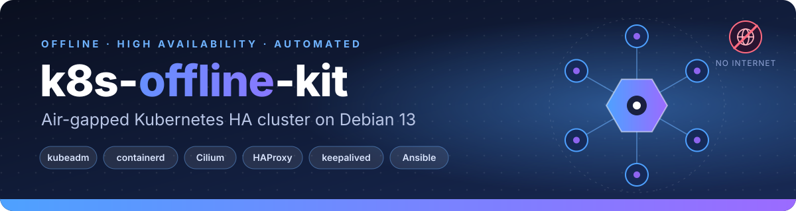
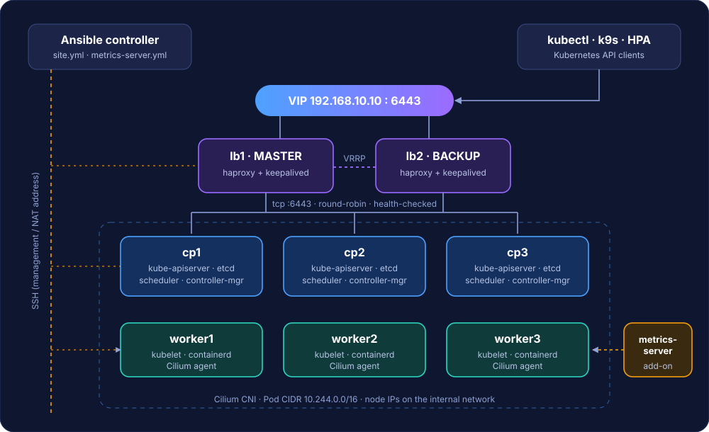
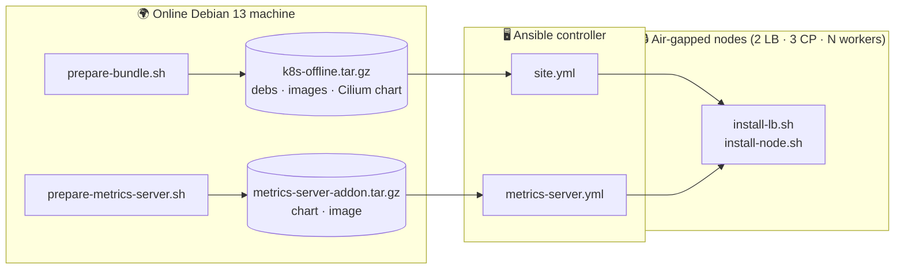
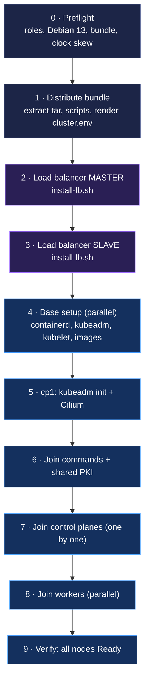

<p align="center">
  
</p>

<p align="center">
  
  
  
  
  
  
  
</p>

<p align="center">
  <b>English</b> · <a href="README.fa.md">فارسی</a>
</p>

<p align="center">
  Build a <b>highly available Kubernetes cluster</b> on <b>Debian 13</b> machines that have <b>no internet access</b> —<br>
  with one Ansible command, from a single downloadable bundle.
</p>

---

## ✨ Highlights

- 🔌 **100% offline install** — every `.deb`, container image and Helm chart is collected once on an online machine and shipped as a tarball.
- 🏗️ **HA out of the box** — 2 load balancers (HAProxy + keepalived VIP), 3 control planes (stacked etcd), N workers.
- 🤖 **One command** — `ansible-playbook site.yml` does the whole thing in the right order, and is safe to re-run.
- 🐝 **Cilium CNI** installed from a local Helm chart.
- 📊 **metrics-server add-on** — `kubectl top`, k9s metrics and HPA out of the box.
- 🧩 **Plain bash underneath** — every step is also a documented script you can run by hand.
- 🌐 **Multi-NIC aware** — manage the VMs over a NAT address while the cluster talks on an internal network.

## 🗺️ Architecture

<p align="center">
  
</p>

| Role | Count | Runs |
|---|---|---|
| Load balancer | 2 | HAProxy (TCP `:6443`, round-robin, health-checked) + keepalived (VRRP VIP) |
| Control plane | 3 | kube-apiserver, etcd, scheduler, controller-manager, kubelet, containerd |
| Worker | 1…N | kubelet, containerd, Cilium agent (+ metrics-server replicas) |
| Ansible controller | 1 | `ansible-core`, `sshpass`, this repository |

The keepalived **VIP is the cluster endpoint** (`--control-plane-endpoint`), so kubelets, `kubectl` and joining nodes all talk to the API through the load balancers.

## 🔄 How it works

Two phases: collect everything **once, online** → install **many times, offline**.



### Playbook order (`ansible/site.yml`)



## 📋 Requirements

| Where | What |
|---|---|
| **Online machine** (one-off) | Debian 13, same CPU architecture as the nodes, internet access, root. A throw-away VM is ideal. |
| **Ansible controller** | `ansible-core` and `sshpass` (only if you log in with passwords). Needs network reachability to the nodes, **not** to the internet. |
| **All nodes** | Debian 13, `python3`, `sudo`, a user Ansible can log in with, synchronized clocks (e.g. internal chrony). |
| **Sizing** | 2 LB + 3 control planes + ≥1 worker. Tested with 2 + 3 + 3. |
| **Network** | Recommended: a second NIC on an internal subnet carrying cluster traffic and the VIP. |

Install the controller tools (online): `sudo apt install -y ansible-core sshpass`.
Offline controller? Add `ansible-core sshpass` to `PKGS` in `prepare-bundle.sh` and install from the bundle's local repo.

## 🚀 Quick start

```bash
git clone https://github.com/alikashki/k8s-offline-kit.git
cd k8s-offline-kit
```

**1 · Build the bundles** — on an *online* Debian 13 machine:

```bash
sudo ./prepare-bundle.sh            # → k8s-offline.tar.gz          (debs, images, Cilium chart)
sudo ./prepare-metrics-server.sh    # → metrics-server-addon.tar.gz (chart, image)
```

Copy the whole directory (including both tarballs) to the Ansible controller.

**2 · Describe your machines** — on the controller:

```bash
cd ansible
cp inventory.example.ini inventory.ini
$EDITOR inventory.ini group_vars/all.yml
```

```ini
[lb_master]
lb1 ansible_host=203.0.113.11 node_ip=192.168.10.11

[lb_slave]
lb2 ansible_host=203.0.113.12 node_ip=192.168.10.12

[cp_first]
cp1 ansible_host=203.0.113.21 node_ip=192.168.10.21

[cp_other]
cp2 ansible_host=203.0.113.22 node_ip=192.168.10.22
cp3 ansible_host=203.0.113.23 node_ip=192.168.10.23

[workers]
worker1 ansible_host=203.0.113.31 node_ip=192.168.10.31
worker2 ansible_host=203.0.113.32 node_ip=192.168.10.32
worker3 ansible_host=203.0.113.33 node_ip=192.168.10.33
```

- `ansible_host` — the address Ansible **SSHes** to (e.g. a NAT address).
- `node_ip` — the **internal** address the nodes use between themselves (goes into `/etc/hosts`, HAProxy backends, kubelet `--node-ip`, API advertise address).
- Control planes **must** be named `cp1`, `cp2`, … (HAProxy backends are generated from these names).

**3 · Build the cluster:**

```bash
ansible-playbook site.yml
```

**4 · Add metrics-server:**

```bash
ansible-playbook metrics-server.yml
```

**5 · Use it:**

```bash
ssh cp1
sudo kubectl --kubeconfig /etc/kubernetes/admin.conf get nodes -o wide
sudo kubectl --kubeconfig /etc/kubernetes/admin.conf top nodes
```

> [!IMPORTANT]
> `inventory.ini` holds credentials and is **git-ignored**. Encrypt secrets with `ansible-vault`, and change `vrrp_auth_pass` in `group_vars/all.yml` before you deploy.

## ⚙️ Configuration

| File | Purpose | Edit when |
|---|---|---|
| `ansible/inventory.ini` | Machines, roles (groups), SSH + sudo credentials, `node_ip` | every environment |
| `ansible/group_vars/all.yml` | VIP, pod CIDR, VRRP settings, add-on settings, paths | every environment |
| `ansible/templates/cluster.env.j2` | Renders `cluster.env` on each node from the inventory | rarely |
| `bundle.env` | **Build-time** versions: Kubernetes channel, Cilium, metrics-server chart | you want other versions → rebuild the bundle |
| `cluster.env` | Same data as `group_vars`, for running the scripts **by hand** | manual use only |

Common switches in `group_vars/all.yml`:

```yaml
vip: "192.168.10.10"             # keepalived VIP = cluster endpoint
pod_cidr: "10.244.0.0/16"
vrrp_interface: "eth1"           # NIC that carries the VIP
vrrp_auth_pass: "CHANGEME"       # 1-8 alphanumerics, same on both LBs
metrics_server_replicas: 2
metrics_server_insecure_tls: true  # lab default, see "Security notes"
```

## 🗂️ Repository layout

```text
k8s-offline-kit/
├── assets/
│   ├── banner.svg
│   └── architecture.svg
├── ansible/
│   ├── ansible.cfg
│   ├── inventory.example.ini      # copy → inventory.ini (git-ignored)
│   ├── group_vars/
│   │   └── all.yml                # VIP, pod CIDR, VRRP, add-on settings
│   ├── templates/
│   │   └── cluster.env.j2         # cluster.env rendered from the inventory
│   ├── site.yml                   # builds the whole cluster
│   └── metrics-server.yml         # installs the metrics-server add-on
├── prepare-bundle.sh              # ONLINE: debs + images + Cilium chart  → k8s-offline.tar.gz
├── prepare-metrics-server.sh      # ONLINE: chart + image                 → metrics-server-addon.tar.gz
├── install-lb.sh                  # offline: HAProxy + keepalived on a load balancer
├── install-node.sh                # offline: base / init / cilium / join / add-ons on a k8s node
├── bundle.env                     # build-time versions
├── cluster.env                    # per-environment settings for manual runs
├── LICENSE
├── README.md
└── README.fa.md
```

Generated and **git-ignored**: `k8s-offline/`, `k8s-offline.tar.gz`, `metrics-server-addon/`, `metrics-server-addon.tar.gz`.

<details>
<summary><b>What is inside <code>k8s-offline.tar.gz</code>?</b></summary>

```text
k8s-offline/
├── repo/                  # local flat apt repo: containerd.io, kubelet, kubeadm, kubectl,
│   ├── *.deb              #   haproxy, keepalived, helm + the full dependency closure
│   ├── Packages(.gz)
│   └── Release
├── images/images.tar      # kube-apiserver/-controller-manager/-scheduler/-proxy, etcd, coredns, pause, Cilium
├── charts/cilium-<v>.tgz  # Cilium Helm chart
├── images.list            # image names (verified after import)
├── bundle.env  cluster.env  install-node.sh  install-lb.sh
└── VERSION  SHA256SUMS
```

</details>

## 🧰 Running the scripts by hand (without Ansible)

Extract the tarball (e.g. into `/opt`), edit `cluster.env`, then:

```bash
# Load balancers
sudo ./install-lb.sh --role master --hostname lb1      # on lb1
sudo ./install-lb.sh --role slave  --hostname lb2      # on lb2

# Every Kubernetes node
sudo ./install-node.sh base --hostname cp1

# First control plane only
sudo ./install-node.sh init
sudo ./install-node.sh cilium

# Other nodes: paste the join command printed by:
sudo ./install-node.sh join-info                       # on cp1
sudo ./install-node.sh join <kubeadm join arguments>
```

<details>
<summary><b>All <code>install-node.sh</code> sub-commands</b></summary>

| Command | Run on | Does |
|---|---|---|
| `base [--hostname N]` | every k8s node | swap off, kernel modules/sysctl, install packages from the local repo, containerd, import images, kubelet |
| `init` | first control plane | `kubeadm init` against the VIP, advertise address = internal IP |
| `cilium` | first control plane | Helm install from the local chart, waits for rollout, diagnostics on failure |
| `join <args>` | other nodes | `kubeadm join` (control-plane joins add `--apiserver-advertise-address`) |
| `join-info` | a control plane | prints fresh join commands (manual flow) |
| `join-cmd [worker\|control-plane]` | first control plane | prints only the join arguments (used by Ansible) |
| `alias-images` | any k8s node | makes digest-pinned images visible to the CRI (idempotent) |
| `import-images <dir>` | any k8s node | imports `<dir>/images.tar` (add-ons) |
| `metrics-server <dir>` | first control plane | installs metrics-server from `<dir>/chart` |

</details>

## 🔁 Idempotency

Every Ansible step is guarded, so you can re-run `site.yml` safely:

| Step | Skipped when |
|---|---|
| Bundle extract | `/opt/k8s-offline/VERSION` exists |
| Load balancer | `/var/lib/k8s-offline/lb.done` exists (force: `-e force_lb=true`) |
| `base` | `/var/lib/k8s-offline/base.done` exists |
| `kubeadm init` | `/etc/kubernetes/admin.conf` exists |
| Cilium | `/var/lib/k8s-offline/cilium.done` exists |
| `join` | `/etc/kubernetes/kubelet.conf` exists |

To ship a **new bundle** (other versions), remove `/opt/k8s-offline` on the nodes first.

## 🧠 Design notes (lessons from real offline installs)

<details>
<summary><b>Local apt repo, zero network lookups</b></summary>

`prepare-bundle.sh` downloads the full dependency closure (using an empty dpkg status so apt believes nothing is installed) and builds a flat repo with `apt-ftparchive`. On the nodes, apt is pointed **only** at that repo through `-o Dir::Etc::SourceList=…`, so there are no timeouts against unreachable mirrors.

</details>

<details>
<summary><b>Digest-pinned images (Cilium) need an alias</b></summary>

The Cilium chart references images as `repo:tag@sha256:…`, but containerd's CRI looks them up as `repo@sha256:…`. Images imported under the first name are *not found* and kubelet tries to pull them → `ImagePullBackOff`. After import, `install-node.sh` creates the `repo@sha256:…` alias (`alias-images`).

</details>

<details>
<summary><b>NAT address for SSH, internal address for the cluster</b></summary>

With two NICs, kubeadm and kubelet pick the IP of the interface that has the default route — usually the NAT one. The kit therefore separates `ansible_host` (management) from `node_ip` (cluster) and sets kubelet `--node-ip` and `--apiserver-advertise-address` to the internal address.

</details>

<details>
<summary><b>Control-plane joins without <code>upload-certs</code></b></summary>

The standalone `kubeadm init phase upload-certs` proved unreliable in an air-gapped network (it tries to reach the internet for version lookups and can time out while bootstrapping RBAC). The playbook instead copies the shared CA / service-account files (`ca`, `sa`, `front-proxy-ca`, `etcd/ca`) from the first control plane to the joining one, then runs `kubeadm join --control-plane` — the manual procedure from the official docs, with no TTL.

</details>

<details>
<summary><b>keepalived 2.x script security</b></summary>

keepalived ≥ 2.x refuses to run `vrrp_script` as root unless `enable_script_security` is set and a non-root `script_user` is configured. `install-lb.sh` creates the `keepalived_script` user and configures this; the health check (`systemctl is-active haproxy`) needs no privileges.

</details>

<details>
<summary><b>HAProxy timeouts for the Kubernetes API</b></summary>

API watch/exec connections are long-lived. `timeout client/server` is set to `3h` and TCP keepalive is enabled (`clitcpka`, `srvtcpka`), instead of a 30 s idle cut-off.

</details>

## 🛠️ Troubleshooting

| Symptom | Cause | Fix |
|---|---|---|
| `kube-proxy` in `CrashLoopBackOff`, log: `open /proc/sys/net/netfilter/nf_conntrack_max: no such file` (Cilium then fails with `dial tcp 10.96.0.1:443: i/o timeout`) | `nf_conntrack` kernel module not loaded | `sudo modprobe nf_conntrack` on every node (the kit now loads it and persists it in `/etc/modules-load.d/`), then restart the pods |
| Cilium pods `ErrImagePull` / `ImagePullBackOff` (pulling from `quay.io`) | digest-pinned image not visible to the CRI | `sudo ./install-node.sh alias-images`, then delete the stuck pods (done automatically by the playbook) |
| `SECURITY VIOLATION - scripts are being executed but script_security not enabled` | keepalived script security | use the current `install-lb.sh` (creates `keepalived_script`) |
| `install-lb.sh` says *VIP missing or invalid* | empty/wrong `cluster.env` (e.g. an empty template) | check `ansible/templates/cluster.env.j2` is not empty and `vip` in `group_vars/all.yml` is a plain IPv4 |
| Need to re-apply LB config | LB step already marked done | `ansible-playbook site.yml -e force_lb=true` |
| Join command step fails | see the task error (secrets are visible by default) | set `-e hide_secrets=true` only after it works |
| `kubectl top` has no data | metrics-server cannot scrape kubelets | `kubectl -n kube-system logs deploy/metrics-server`; see TLS note below |
| Odd etcd / certificate errors | clock skew between nodes | sync time (internal chrony); preflight fails above 60 s |
| `crictl: command not found` | `cri-tools` is not in the bundle | use `ctr -n k8s.io images ls` instead |

## 🔐 Security notes

- Credentials in `inventory.ini` are plain text by default → use **ansible-vault**; the file is git-ignored.
- `vrrp_auth_pass` is a shared secret between the load balancers — change the example value.
- metrics-server runs with `--kubelet-insecure-tls` by default because kubeadm kubelets use self-signed serving certificates. Fine for a lab; for production enable kubelet `serverTLSBootstrap`, approve the `kubelet-serving` CSRs and set `metrics_server_insecure_tls: false`.
- Join tokens and certificate keys are short-lived; the playbook creates fresh ones on every run.

## 📄 License

[MIT](LICENSE) © 2026 Ali Kashki
